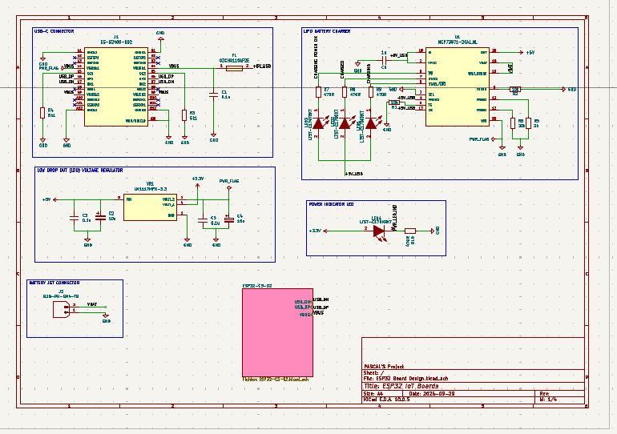
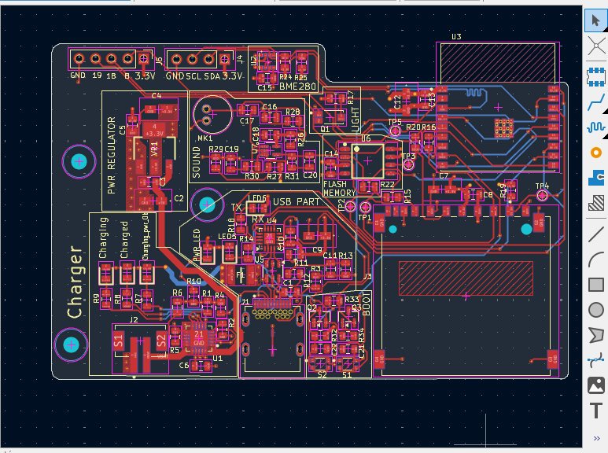
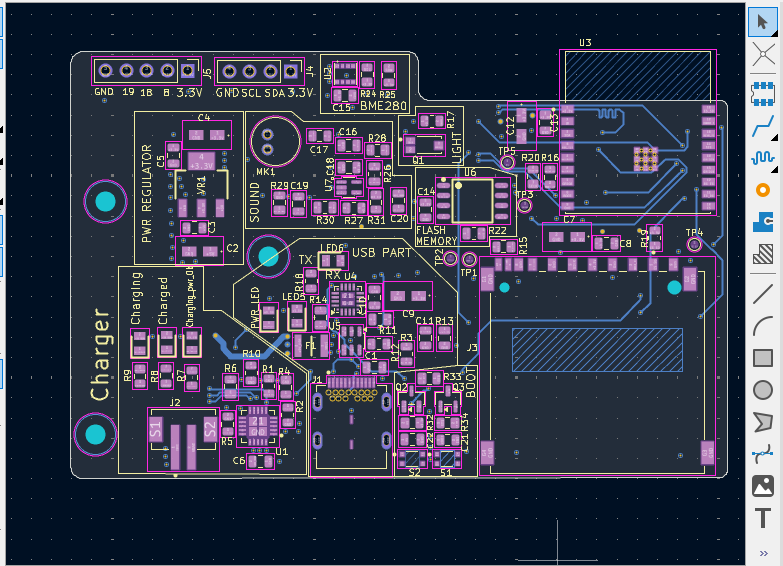

<<<<<<< HEAD
# ESP32-C3-IoT-Board
Board ESP32 IoT board for learning Kicad
=======
# ESP32-C3 IoT Development Board

A custom-designed IoT development board built around the **ESP32-C3-02**, featuring USB-C connectivity, Li-ion battery charging, environmental sensing, audio input, and removable storage.

## Project Overview

This project focuses on the design of a compact, custom PCB for IoT applications using KiCad. The board integrates wireless connectivity, power management, sensors, and data storage into a single hardware platform.

## Key Features

- **Microcontroller:** ESP32-C3-02 with Wi-Fi and Bluetooth Low Energy (BLE).
- **Power Management:** TP4056-based single-cell Li-ion battery charging.
- **USB-C:** USB connectivity and power input.
- **Environmental Sensing:** BME280 for temperature, humidity, and atmospheric pressure.
- **Audio Input:** Onboard microphone for sound acquisition.
- **Data Storage:** MicroSD card interface and additional flash memory.
- **Display Interface:** I²C interface for an optional OLED display.
- **Status Indicators:** LEDs for power and charging status.
- **Expansion:** Interfaces for additional sensors and peripherals.

## Hardware Design

### 1. Schematic

The schematic defines the electrical connections between the ESP32-C3-02, charging circuit, sensors, storage interfaces, and peripheral connectors.

### 2. PCB Layout

The PCB layout implements the circuit connections, component placement, routing, and board geometry.

| Front Side | Bottom Side |
|---|---|
|  |  |

### 3. 3D PCB Visualization

The 3D model provides a visual representation of the assembled PCB and component placement.

## Design Highlights

- Compact PCB layout designed in KiCad.
- USB-C and rechargeable Li-ion battery power options.
- Integrated wireless connectivity through the ESP32-C3.
- Sensor interfaces for environmental and audio data acquisition.
- MicroSD storage for data logging applications.
- Design files available for inspection and further development.

## Repository Contents

- **KiCad schematic:** `.kicad_sch`
- **KiCad PCB layout:** `.kicad_pcb`
- **3D visualizations:** PCB rendering images.
- **Gerber files:** Manufacturing output files, when included.
- **Bill of Materials (BOM):** Component list and procurement information.
- **Documentation:** Design screenshots and supporting resources.

## Tools

- KiCad
- PCB design and routing
- Electronic schematic capture
- 3D PCB visualization

## Potential Applications

- IoT environmental monitoring
- Portable data logging
- Wireless sensor nodes
- Embedded systems prototyping

## Project Status

PCB design and visualization completed. Hardware manufacturing, assembly, and functional validation should be documented as those stages are completed.

## Author

**Pascal Malle**

Electrical, Electronic and Telecommunications Engineering

---

*This project is intended for learning, prototyping, and further development. Verify the charging and battery-protection circuitry against the selected components' datasheets before manufacturing or powering the board.*
>>>>>>> 4541118 (Add ESP32-C3 IoT PCB design)
